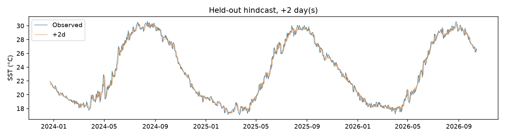

# ThermaTwin SST model kartı

Değerlendirme tarihi: 16 Ekim 2026. Kaydedilen modeller yerel `artifacts/` klasöründedir; sayısal değerlendirme kopyaları bu klasördedir.

## Güvenilirlik 0.3 — güncel değerlendirme

Mevcut model ağırlıkları, gözlemler ve PDF'ler korundu. Nokta tahminleri değişmedi. Sekiz yıllık rolling-origin deneyi, validation ile seçilen uyarı politikası, ufuk/mevsim bazlı residual aralıkları ve dört durumlu yerel uyarı motoru eklendi. Dashboard mevcut tasarımla bu sonuçları gösterir. Supabase, OTP, Resend ve e-posta etkinleştirilmedi.

2019–2026 rolling-origin: eğitim her yıl genişler, ardından ayrı validation yılı ve ayrı kalibrasyon yılı gelir; günlük başlangıçlar test edilir. MAE **0.2484 / 0.3335 / 0.3626 °C**, RMSE **0.3376 / 0.4492 / 0.4993 °C**. Persistence'a göre MAE kazancı **%6.25 / %10.31 / %12.74**. Eğitimden mevsimsel ortalama ve önceki yılın aynı günü baseline'ları da aynı tarihlerde değerlendirildi. Son yıl 16 Ekim'de biter.

Orijinal modelin ayrı testinde yeni uyarı politikasının Precision/Recall/F1 sonuçları:

| Ufuk | Precision | Recall | F1 | Günlük FP | Günlük FN | Persistence F1 |
|---|---:|---:|---:|---:|---:|---:|
| 24 saat | 0.8454 | 0.8415 | 0.8435 | 66 | 68 | 0.8465 |
| 48 saat | 0.7830 | 0.7757 | 0.7793 | 92 | 96 | 0.7858 |
| 72 saat | 0.7365 | 0.7658 | 0.7509 | 117 | 100 | 0.7594 |

P90/P95 tetikleri, üç kaynak ve üç marjdan oluşan 18 aday **aynı gözlenmiş P90 etiketine karşı yalnız validation'da** seçildi. 24/48 saatte son gözlem + mevsimsel değişim/P90, 72 saatte persistence/P95−0.2 °C seçildi. +24/+48 saatte eski model kuralından iyi, +72 saatte daha kötü; **üç ufukta da persistence F1'ını geçmiyor**. Test sonuçlarına bakılarak kural değiştirilmedi. Ayrı P95 gerçek etiketinin sonuçları tanısaldır; etiket değiştirerek başarı artışı iddia edilmez.

%80 hedefli aralıklar her ufukta bağımsız kalibre edildi. Doğrudan `ceil((n+1)×0.8)` sıra istatistiği; en az 60 mevsim örneği varsa genel ve mevsimsel yarıçapın büyüğü alınır. Test kapsaması eski **%80.25 / %78.19 / %77.78** yerine **%81.71 / %81.21 / %81.09**; ortalama genişlik **0.884 / 1.166 / 1.236 °C**. Ancak ≥0.5 °C yükselen günlerde kapsama yalnız **%6.74 / %36.13 / %39.77**. Toplam kapsama koşullu güvenilirlik veya bir olayın olasılığı değildir. Zaman bağımlılığı nedeniyle formal conformal garanti iddia edilmez.

Birleşik motor 1.026 başlangıçta 49 kayıt provası (11 öngörü, 38 gözlem) üretip 439 tekrarı bastırdı. 18 uzun olayın 8'i saptandı, 10'u kaçırıldı; **yalnız 2'si başlamadan yakalandı**. 38 kayıt beş günlük olaya denk gelmedi; bir kayıt sınırda sansürlü. Olay precision/recall/F1: **0.1739 / 0.4444 / 0.2500**. Bunlar e-posta gönderim sayıları değildir. İki normal günle yeniden kurulum yakın olayları birleştirip kaçırabilir.

Motor `normal`, `observed_anomaly`, `forecast_risk`, `insufficient_data` durumlarını ayırır. Sebep, ufuk, veri tarihi, aralık ve tekrar bastırma kaydı saklanır. Aynı gün yeniden çağrı yeni bildirim üretmez; öngörüden gözlemsel anomaliye geçiş ayrı teyit kaydıdır. Eksik/eski veri yeni uyarı üretmez. Statik UI kopyasında güncellik tarayıcı tarihinde de kontrol edilir. İki ek gerçek replay örneği başarı ve yanlış olayı birlikte gösterir: **27 Ocak 2025** (30 Ocak'taki olaya ön sinyal) ve **21 Kasım 2024** (beş günlük olaya dönüşmeyen sinyal). Bu iki örnek genel metrikleri seçmek için kullanılmadı.

Referans duyarlılığı: eğitimden dondurulmuş P90'ı aşan gün oranı eğitimde %9.52, eski ayrı testte %41.79; yalnız eğitimdeki son 10 tamamlanmış yıl kullanılsa test oranı %38.39. İkisi de 30 yıllık standart referans değildir. Isınan dönem/referans kayması daha sık uyarı üretebilir; test oranına bakılarak referans seçilmedi.

**Kullanım kararı:** yerel gözlem ve araştırma prototipi; bağımsız otomatik erken uyarı için hazır değil. Daha önce incelenmiş geçmiş seri üzerindeki bu çalışma ileriye dönük bağımsız saha deneyi değildir. Operasyonel yayın gecikmesi, arşiv revizyonları, ölçüm hatası, başka bölgeye genelleme ve ekolojik sonuçlar doğrulanmadı. Rolling testinde ekstrem P95 gün MAE'si üç ufukta da persistence'tan kötü; ani yükselişlerde aşağı yönlü bias sürüyor.

Tam yıl/mevsim/olay tabloları ve yöntem kaynakları: [RELIABILITY_REPORT.md](RELIABILITY_REPORT.md). Sayısal kayıt: [reliability-report.json](reliability-report.json). Kod: `backend/thermatwin/reliability.py`, `warning.py`; tekrar üretim: `python scripts/evaluate_reliability.py`. Yeni deneyler `artifacts/reliability/v1/` altında, özgün modellerin dışında tutulur.

Doğrulama: 26 Python, 13 frontend birim testi, dört boyutta 28 production E2E ve son doğrulama değişikliği için 16 hedefli E2E tekrar başarılı. SQL/RLS, lint, TypeScript ve production build başarılı. API/UI aynı replay kalibrasyonunu verir; API ve istemci güncelliği tekrar kontrol eder. Koruma manifestindeki yedi dosyanın SHA-256 değerleri değişmedi. NumPy/Pandas ve Starlette bağımlılıklarında mevcut deprecation uyarıları var.

Aşağıdaki bölümler ilk model ve UI/UX 0.2 denetiminin geçmiş kaydıdır; eski aralık/F1 sonuçları yukarıdaki karşılaştırmanın başlangıç noktasıdır.

## Amaç ve veri

Akkuyu açıklarında bölgesel ortalama **günlük foundation SST** değerini son gözlemden +1, +2 ve +3 gün için tahmin etmek. Anlık sensör ölçümü, santral kaynaklı termal etki, gerçek plume veya biyolojik zarar tahmini değildir.

Birincil kaynak: Copernicus Marine `SST_MED_SST_L4_NRT_OBSERVATIONS_010_004_c_V2`, sürüm `202311`, `analysed_sst`, `mask`. Bölge 35.95–36.15° N, 33.40–33.70° E. 1 Ocak 2008–16 Ekim 2026, 6.864 gün; eksik gün yok. NetCDF kara maskesiyle deniz hücreleri seçildi, Kelvin doğrulandı, enlem ağırlıklı alan ortalaması alındı. Veri kökeni ve SHA-256: [copernicus-evaluation.json](copernicus-evaluation.json).

NOAA OISST v2.1 yalnız ayrı bir karşılaştırmadır: 35.875° N / 33.625° E, 0.25°, 2008–2025, 6.558 geçerli/17 eksik gün. Sonuç: [noaa-evaluation.json](noaa-evaluation.json). Kıyı detayları için yeterli çözünürlükte değildir.

## Yöntem

- Takvim günleri eksiksiz indekslenir; boş günler doldurulmaz. Özellik/target eksikse ilgili örnek kullanılmaz.
- Güncel SST, 1/2/3/7/14 gün lag, 3/7/14 gün ortalama, 7 gün standart sapma, 3/7 gün farkı, yılın günü sin/cos.
- Üç ayrı XGBoost delta modeli; 350 ağaç, derinlik 3, öğrenme oranı 0.035, sabit seed. Bilinen geleceğe ait gözlem/meteoroloji kullanılmaz.
- Ayarlama bloğunda seçilen persistence ağırlığı. Yalnız persistence daha iyiyse model bunu seçebilir ve açıkça belirtir. Bu Copernicus deneyinde üç ufukta XGBoost delta ağırlığı 0.75 seçildi.
- Ayrı kalibrasyon bloğundaki mutlak hatanın sonlu örneklem düzeltilmiş %80 yüzdeliği, simetrik ampirik tahmin aralığı olarak kullanılır. Bağımsızlık/değişmez dağılım varsayımı zaman serisinde garanti edilmez.
- Eğitim: 1 Ocak 2008–19 Mart 2020. Ayarlama: sonrasında 4 Şubat 2022'ye kadar. Kalibrasyon: sonrasında 22 Aralık 2023'e kadar. Test: 23 Aralık 2023–16 Ekim 2026. Hedef gün kendi bloğunun sonunu geçemez; sınırdaki ufuklar temizlenir.

## Ayrılmış gerçek test sonuçları

| Ufuk | N | MAE °C | RMSE °C | Bias °C | Persistence MAE °C | P90 F1 | Sıcak gün N | Sıcak gün MAE °C | %80 kapsama |
|---|---:|---:|---:|---:|---:|---:|---:|---:|---:|
| +1 | 1028 | 0.2649 | 0.3547 | -0.0204 | 0.2807 | 0.8416 | 429 | 0.2562 | %80.25 |
| +2 | 1027 | 0.3520 | 0.4667 | -0.0367 | 0.3910 | 0.7611 | 428 | 0.3397 | %78.19 |
| +3 | 1026 | 0.3799 | 0.5127 | -0.0451 | 0.4358 | 0.7558 | 427 | 0.3616 | %77.78 |

Persistence'a göre MAE iyileşmesi yaklaşık %5.6 / %10.0 / %12.8. Metrikler tek bir bölgesel ortalama seriye aittir; mekânsal/genel bilimsel doğrulama değildir. Aralıkların özellikle +2/+3 gün kapsaması hedefin altındadır. Tek sabit test bloğu kullanıldı; rolling-origin çapraz doğrulama henüz uygulanmadı.

## Anomali referansı ve yorum sınırları

Klimatoloji yalnız eğitim dönemindendir. Yıl içi takvim, Şubat 29'u da içeren sabit bir takvime eşlenir. ±5 gün havuzundan ortalama/P90 hesaplanıp 31 gün dairesel olarak yumuşatılır. Bu referans kısa ve 2020 yılı kısmi olduğu için standart 30 yıllık klimatoloji değildir; ısınan denizde eşik aşımı sıklığını yükseltebilir. Sıcak gün F1, bu tanımlı P90 etiketinin tahminidir; bağımsız uzman risk etiketi değildir.

Tek gün P90 aşımı inceleme sinyalidir. En az beş ardışık **gözlenmiş** gün, MHW koşulu olarak gösterilir; ilk dört gün geleceğe bakarak geriye dönük etiketlenmez. Eksik gün seriyi kırar. İki günlük araları birleştiren gelişmiş olay tanımı uygulanmadı. Tahmini eşik aşımı gözlemsel MHW teyidi sayılmaz.

“Yüksek” sınıfı, SST−referans farkının `2 × (P90−referans)` üzerinde olmasıdır. Bu sezgisel tarama kuralı tür bazlı zarar eşiği değildir. Kıyı çözünürlüğü, ürün revizyonları, mevsimsel kayma ve tesis telemetrisi yokluğu yorumu sınırlar. PDR'deki yüksek risk F1 veya tesis etkisi hedeflerinin sağlandığı iddia edilmez.

Tam kod kuralı: SST P90'ı aşıyorsa ve `SST − referans ≥ 2 × max(P90 − referans, 0.1 °C)` ise yüksek inceleme önceliği; aksi halde dikkat. `0.1 °C` tabanı birbirine çok yakın referans/eşik için sayısal korumadır, biyolojik eşik değildir.

## Historical Replay

Test döneminde, ≥5 günlük eşik aşımı gösteren ve geçerli geçmiş özellikleri bulunan günler arasından en büyük pozitif mevsimsel anomalili gün seçildi: **7 Haziran 2024**. Bu seçim uç bir olayı göstermek içindir; başarı örneği seçerek genel performans hesaplanmaz. Metrikler yukarıdaki test döneminin tamamındandır.

Replay tahminine olay tarihinden sonraki hiçbir gözlem girmez. Test, gelecekteki bütün değerler değiştirilse bile replay tahminlerinin aynı kaldığını doğrular. Kod kalibrasyon döneminin içindeki replay tarihlerini reddeder. Raporlar ve test e-postaları geçmiş olay olarak etiketlenir.

## Yeniden üretim

README'deki Copernicus download → train → replay komutları, `uv.lock` ortamında gerçek veriden sonuçları yeniden üretir. Kaynak arşivi güncellenirse sonuçlar değişebilir; bu nedenle indirilen NetCDF ve hash manifesti korunur. Yerel CSV/PNG çıktıları `artifacts/SST_MED_SST_L4_NRT_OBSERVATIONS_010_004_c_V2/` altındadır. Joblib yalnız güvenilir yerel eğitim çıktısından yüklenir.

## UI/UX 0.2 sırasında bağımsız yeniden hesaplama

16 Ekim 2026'da `scripts/audit_model.py --catalogue` ile mevcut modeller **yeniden eğitilmeden** denetlendi. MAE, RMSE ve bias kayıtlı hindcast CSV'lerinden tekrar hesaplandı; kayıtlı modelin tahminleri CSV ve dashboard snapshot'larıyla eşleşti. Ham NetCDF SHA-256 doğrulandı. Klimatoloji yalnız eğitim diliminden yeniden hesaplandığında kayıtlı referansla eşleşti. Gelecekteki gözlemler değiştirilince geçmiş olay tahminleri değişmedi. Katalogdaki gerçek zaman ekseni son günü 16 Ekim 2026 olarak doğrulandı; yerel 6.864 günlük seride eksik gün yok.

PDF'ler, iki model ve mevcut gözlem dosyaları `preservation-manifest.json` ile hash kontrolünden geçti. Denetim dosyası: [model-audit.json](model-audit.json). Model dosyalarının byte'ları değişmedi.

Bir hata düzeltildi: doğrudan `forecast` çağrısı, veride olmayan bir tarih verilirse son mevcut özellikleri bu yanlış tarihe etiketleyebiliyordu. Başlangıç tarihinin indeks içinde ve günlük gözlem zamanında olması zorunlu kılındı. Mevcut geçerli tahminler değişmedi.

### Uyarı başarısı sıcaklık doğruluğuyla aynı değil

| Ufuk | Model P90 F1 | Persistence P90 F1 | En büyük mutlak test hatası |
|---|---:|---:|---:|
| +24 saat | 0.8416 | 0.8465 | 1.7438 °C |
| +48 saat | 0.7611 | 0.7858 | 2.8573 °C |
| +72 saat | 0.7558 | 0.7594 | 3.4546 °C |

**Üç ufukta da persistence sıcak gün F1'ı daha yüksek.** Model ağırlıkları validation MAE'sine göre seçildi; F1'ı iyileştirmek için test verisinde ayar yapılmadı. En büyük hatalar 5 Mayıs 2024 hedef gününde; +72 saatte tahmin 22.807 °C, gözlem 19.352 °C. Bunun fiziksel nedeni bu veriyle doğrulanmış değildir. Hava/akıntı verisi olmadan nedensel açıklama uydurulmaz.

Bu denetimden sonra planlanan rolling-origin, ayrı validation üzerinde P90/P95 uyarı stratejisi ve mevsime göre aralık kalibrasyonu, yukarıdaki 0.3 çalışmasında uygulandı. Mevcut test dönemi yeniden ayarlama verisi olarak kullanılmamalı.

### Yeni replay kataloğu

`public/replay-events.json` üç gerçek olayı içerir: 25 Aralık 2023, 7 Haziran 2024 ve 5 Aralık 2025. ≥5 günlük koşulu sağlayan, ayrılmış dönemden en yüksek pozitif anomalili adaylar arasından, birbirinden en az 45 gün uzak tarihler seçildi. Genel performans bu üç seçili olaydan hesaplanmadı.

Normal gün karşılaştırması, olaydan en az iki hafta önceki aynı takvim ayında bulunan normal gözlemler arasından, referansa mutlak farkı en küçük olan gerçek gündür. Bu seçilmiş bir görsel bağlamdır; nedensel kontrol grubu veya tüm normal dönemlerin temsili olduğu iddia edilmez. Orijinal 7 Haziran replay dosyası korundu.
