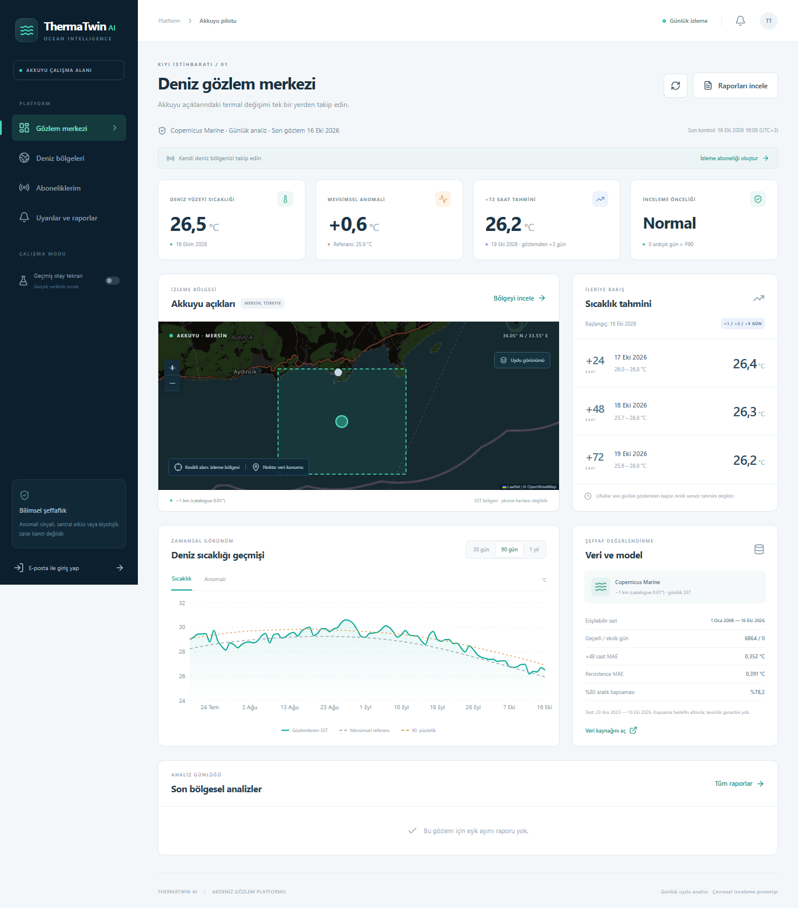
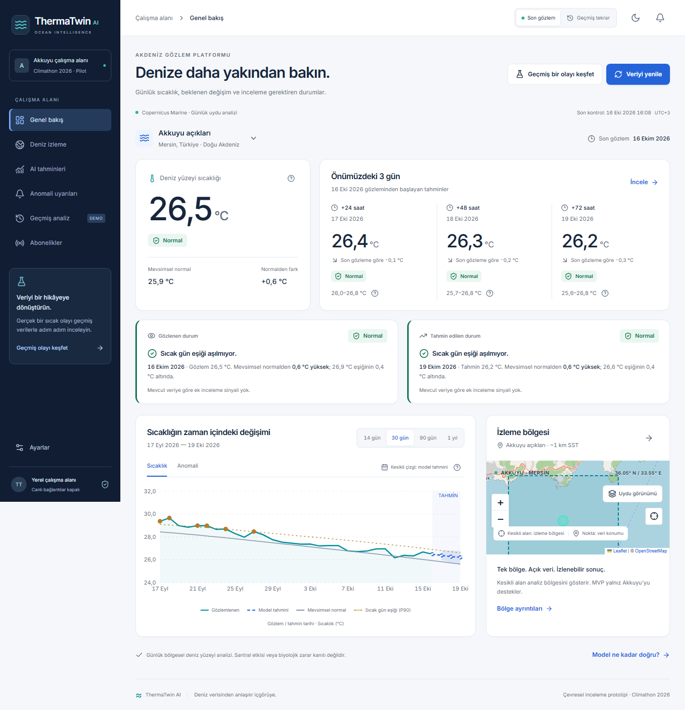

# UI/UX önce ve sonra

16 Ekim 2026. Aynı gerçek Copernicus snapshot'ı, aynı sabit tarayıcı tarihi ve ekran genişlikleriyle alınan tam sayfa görüntüleridir. Önceki modeller, PDF'ler ve gözlem verisi değiştirilmedi.

| Ekran | Önce | Sonra |
|---|---|---|
| Desktop 1920 px | [Önce](screenshots/before-1920.png) | [Sonra](screenshots/after-1920.png) |
| Laptop 1366 px | [Önce](screenshots/before-1366.png) | [Sonra](screenshots/after-1366.png) |
| Tablet 768 px | [Önce](screenshots/before-768.png) | [Sonra](screenshots/after-768.png) |
| Mobile 390 px | [Önce](screenshots/before-390.png) | [Sonra](screenshots/after-390.png) |

## Laptop karşılaştırması

Önce:

Sonra:

Yeni düzende son sıcaklık ve üç ufuk yukarıdadır. Normalden fark, eşik aşımıyla karıştırılmaz. İki ayrı kart gözlenen ve tahmin edilen durumu açıklar. Teknik metrikler ayrı performans ekranındadır. Grafik artık gelecek tahminlerini ve aralığı da gösterir. Harita ana grafikten daha az alan kaplar.

Koyu tema: [laptop](screenshots/dark-1366px.png), [mobil](screenshots/dark-390px.png).
