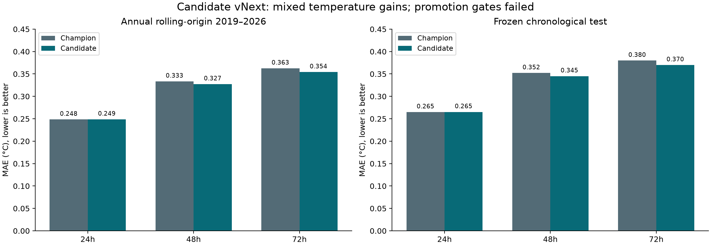

# ThermaTwin Forecasting Engine — candidate vNext

**Decision: retain the champion. Do not promote.** No live model, policy, workflow flag, account, data or mail was changed.

Evaluation: 2026-10-17T19:53:27.435984+00:00. Protocol `candidate-vnext-2026-10-17-v1` was committed before fitting at `6c859ec18ce23305deb92af86f0813e30af32ac2`. This is an already-inspected retrospective series, not a prospective validation or a proprietary foundation model.

The experiment adds nine causal trend/acceleration/seasonal-interaction features to the original 14. Two declared XGBoost residual objectives and five persistence weights are compared only on validation data per horizon/fold. Calibration uses its separate historical block. Test selection or post-result tuning was not performed.

## Annual rolling-origin 2019–2026

All methods use identical observed target dates; negative gain means worse than champion. Seasonal/persistence errors and full diagnostics are in `report.json` and the packaged traces.

| Horizon | N | Champion MAE °C | Candidate MAE °C | Gain vs champion | Candidate RMSE °C | Coverage | Width °C |
|---|---:|---:|---:|---:|---:|---:|---:|
| +24h | 2838 | 0.248394 | 0.248722 | -0.132% | 0.335820 | 84.32% | 0.871 |
| +48h | 2830 | 0.333453 | 0.327295 | +1.847% | 0.441394 | 84.49% | 1.144 |
| +72h | 2822 | 0.362608 | 0.354128 | +2.339% | 0.487697 | 84.62% | 1.264 |

| Horizon | Candidate / champion warning F1 | Candidate / champion recall | Candidate FP / FN | Rapid-warming MAE °C | Rapid-warming coverage |
|---|---:|---:|---:|---:|---:|
| +24h | 0.8146 / 0.8105 | 0.8360 / 0.8307 | 165 / 125 | 0.6519 | 21.15% |
| +48h | 0.7579 / 0.7466 | 0.7879 / 0.7918 | 221 / 161 | 0.6371 | 50.50% |
| +72h | 0.7204 / 0.7191 | 0.7685 / 0.7804 | 276 / 175 | 0.6508 | 57.17% |

Combined engine: candidate detected 13/34 events, 2 early; champion detected 14/34, 3 early. False-event notices: candidate 109, champion 109.

Early lead days, one earliest qualifying notice per retrospectively labeled event: candidate [3, 1] (mean 2.000d, N=2), champion [3, 1, 1] (mean 1.667d, N=3). Conditional lead-time means exclude missed events and are not a measure of improved early detection.

Failed predeclared gates: `1d/mae_gain`, `2d/mae_gain`, `early_events`. All gate decisions are recomputed in CI.

## Frozen chronological test

All methods use identical observed target dates; negative gain means worse than champion. Seasonal/persistence errors and full diagnostics are in `report.json` and the packaged traces.

| Horizon | N | Champion MAE °C | Candidate MAE °C | Gain vs champion | Candidate RMSE °C | Coverage | Width °C |
|---|---:|---:|---:|---:|---:|---:|---:|
| +24h | 1028 | 0.264866 | 0.265141 | -0.104% | 0.353898 | 81.52% | 0.874 |
| +48h | 1027 | 0.352035 | 0.345105 | +1.969% | 0.457077 | 81.50% | 1.133 |
| +72h | 1026 | 0.379851 | 0.369893 | +2.622% | 0.497640 | 81.58% | 1.183 |

| Horizon | Candidate / champion warning F1 | Candidate / champion recall | Candidate FP / FN | Rapid-warming MAE °C | Rapid-warming coverage |
|---|---:|---:|---:|---:|---:|
| +24h | 0.8435 / 0.8435 | 0.8415 / 0.8415 | 66 / 68 | 0.6829 | 13.48% |
| +48h | 0.7793 / 0.7793 | 0.7757 / 0.7757 | 92 / 96 | 0.6669 | 46.45% |
| +72h | 0.7509 / 0.7509 | 0.7658 / 0.7658 | 117 / 100 | 0.6522 | 49.43% |

Combined engine: candidate detected 8/18 events, 2 early; champion detected 8/18, 2 early. False-event notices: candidate 38, champion 38.

Early lead days, one earliest qualifying notice per retrospectively labeled event: candidate [3, 1] (mean 2.000d, N=2), champion [3, 1] (mean 2.000d, N=2). Conditional lead-time means exclude missed events and are not a measure of improved early detection.

Failed predeclared gates: `1d/mae_gain`, `2d/mae_gain`. All gate decisions are recomputed in CI.

## Why the champion remains

The required ≥2% MAE improvement did not hold at 24h or 48h in either protocol. Rolling combined-engine early detections regressed from three to two. Per-horizon warm-day metrics do not imply better event warning; frozen warning F1 remains below persistence. Reduced 72h temperature error cannot offset the failed gates. No significance test or general accuracy percentage is claimed.

Observed-condition decisions are the unchanged SST/P90 rule; their input values and quality gates are identical. Only forecast-dependent candidates differ. The fixed 80% seasonal calibration method was retained for comparability; rapid-warming coverage is still poor. Year/season metrics and regression gates are retained even where pooled averages improve.

## Evidence, runtime and limits

- `protocol.json`: predeclared selection, all parameters and gates; `report.json`: complete folds, candidate validation board, yearly/seasonal/subgroup/interval/daily/event diagnostics and decision.
- `held-out-predictions.csv.gz`: all 23,142 candidate/champion comparison records, with origin/target/horizon/scope/strategy. `evidence-manifest.json` fingerprints these, the report and processed input. Original per-fold CSVs remain in the separate ignored experiment directory.
- `runtime-bundle.zip` and `runtime-manifest.json`: separate ~261 KB package in the exact existing three-member format. CI installs it into a temporary directory, validates hashes, unpickles actual estimators and runs the existing forecast/calibrated snapshot path. Corrupt bundles are rejected. The current runtime manifest and model/policy are untouched; it is not activated.
- Source data: archived revised Copernicus L4 daily ROI mean through 16 October 2026. Historical publication/availability timestamps are unavailable; no latency or exogenous forecast benefit is claimed. Region, reference-period and ecological/causal limitations remain.
- Initial execution stopped at a string/Timestamp conversion in 2019 event lead-time reporting. Partial predictions were preserved; date normalization was repaired with identical declared parameters/gates, then one complete run finished. No score-driven search expansion or candidate promotion occurred.

Locked runtime versions: xgboost 3.4.1, scikit-learn 1.9.1, numpy 2.5.4, pandas 2.3.3, joblib 1.6.0; Python 3.12.15.

Reproduce on an isolated copy with the original local scientific inputs: `python scripts/evaluate_challenger.py`, then `python scripts/package_challenger_evidence.py`, then `python scripts/write_challenger_report.py`. The first two refuse to overwrite an existing completed experiment/evidence. Do not remove existing evidence to tune on the same test. Use a new declared protocol and independent future evaluation for subsequent research.

Owner approval is required for any future model/policy promotion. This experiment does **not** recommend it.
